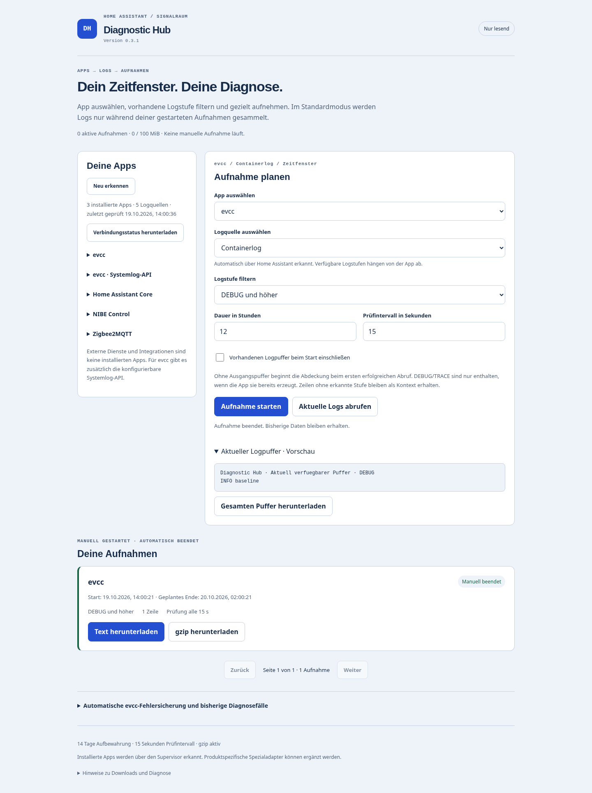

# Diagnostic Hub · Signalraum

**App auswählen → vorhandene Logstufe filtern → Zeitfenster aufnehmen.**

Diagnostic Hub erkennt installierte Home-Assistant-Apps über den Supervisor und bietet deren Containerlogs an. Starte zum Beispiel eine **12-Stunden-Aufnahme mit DEBUG und höher**, beende sie bei Bedarf selbst und lade die gesicherten Daten als Text oder gzip herunter. Logstufen und Geräte werden nicht verändert.

**Version 0.3.1** · Raspberry Pi 5 / `aarch64` und `amd64` · Deutsche mobile Ingress-Oberfläche



## Korrekturen in 0.3.1

Die Oberfläche startet auch bei gewöhnlichem HTTP-Zugriff im Heimnetz. App und Logquelle haben eigene Auswahlfelder. Die Versionsnummer steht direkt in der Oberfläche; Erkennungsfehler werden deutlich angezeigt. Über **Verbindungsstatus herunterladen** erhältst du einen JSON-Bericht ohne Tokens, private URLs oder Logs.

Falls Home Assistant das Update noch nicht anbietet: Im App-Store **⋮ → Nach Updates suchen** wählen, dann Diagnostic Hub aktualisieren, neu starten und die Weboberfläche neu öffnen. Eine lokale ZIP-Installation erhält keine Repository-Updates.

## Aufnahmefunktionen seit 0.3.0

- Automatisch erkannte installierte Apps, zum Beispiel evcc, Zigbee2MQTT oder NIBE Control **sofern als App/Add-on installiert**. Integrationen sind keine separaten Add-ons; ihre Meldungen können im ebenfalls angebotenen Home-Assistant-Core-Log stehen.
- App → Logquelle → TRACE/DEBUG/INFO/WARN/ERROR-Filter → Aufnahmedauer und Prüfintervall. Die konfigurierbare evcc-Systemlog-API bleibt eine zusätzliche Quelle für lokale oder externe evcc-Instanzen.
- **Manuelle Aufnahme als Standard**, keine dauerhafte Logsammlung im Leerlauf. Die bisherige automatische evcc-Fehlersicherung ist zusätzlich einschaltbar.
- Start/Beenden, fester Endzeitpunkt, optionaler Ausgangspuffer, Zwischenstand- und Abschlussdownload. Standard: zwölf Stunden, 15 Sekunden Prüfintervall. Bis zu acht gleichzeitige Aufnahmen; getrennte Quellen werden mit bis zu vier parallelen Abrufen gelesen.
- Logs und Leseposition werden gemeinsam in SQLite gespeichert. Neustarts setzen weder Endzeit noch bereits gesicherte Logs zurück. Abrufpausen, Pufferrotation und Kapazitätsgrenzen werden sichtbar gemacht.

## Installation oder Update

Home Assistant mit Supervisor/Add-on-Unterstützung erforderlich, insbesondere Home Assistant OS. Home Assistant Container allein unterstützt keine Add-ons.

1. Im Add-on-/App-Store unter **⋮ → Repositories** diese URL hinzufügen:
   ```text
   https://github.com/Soul7495/-HA-Signalraum
   ```
2. **Diagnostic Hub** installieren bzw. auf **0.3.1** aktualisieren und neu starten. Supervisor baut das passende Image aus dem Dockerfile.
3. Die neue Version benötigt `hassio_api: true` und die Supervisor-Rolle `manager` für appübergreifende Logzugriffe. Sie verwendet daraus ausschließlich die freigegebenen **GET-Endpunkte**, keine Start-/Stop-/Optionszugriffe auf andere Apps. Es wird kein Host-Port freigegeben.
4. **Weboberfläche öffnen**, **Neu erkennen**, App und Logquelle wählen. Die evcc-Adresse muss für automatisch erkannte Containerlogs nicht eingetragen werden. Nur für die zusätzliche evcc-Systemlog-API ist eine passende URL/API-Authentifizierung erforderlich.
5. Logfilter und Dauer wählen, **Aufnahme starten**. DEBUG/TRACE müssen in der betreffenden App bereits erzeugt werden; das stellt der Betreiber dort selbst ein.

Beim Update wird die automatische evcc-Fehlersicherung ohne explizite Option `automatic_evcc_enabled: true` ausgeschaltet. Bisherige Diagnosefälle bleiben innerhalb der Aufbewahrungs-/Speicherregeln verfügbar.

[Einrichtung, Aufnahmeregeln und Grenzen](diagnostic_hub/DOCS.md) · [Prüfbericht](reports/VERIFICATION.md) · [Änderungen](diagnostic_hub/CHANGELOG.md)

## Grenzen

Automatisch erkannt werden **installierte Supervisor-Apps**, keine beliebigen externen Dienste oder dedizierten Logdateien jeder Integration. TRACE ist ein Filter verfügbarer Zeilen und wird nicht aktiviert. Ohne eingeschlossenen Ausgangspuffer beginnt die Datenabdeckung beim ersten erfolgreichen Abruf. Identische volle Logpuffer ohne Sequenznummern bleiben grundsätzlich mehrdeutig.

Standardmäßig 14 Tage Aufbewahrung und **100 MiB Gesamtgrenze**. Für atomare Datenbanktransaktionen wird Journalplatz reserviert; bei voller Aufnahmekapazität endet eine Aufnahme vorzeitig und behält bisherige Daten. Mehrere intensive Quellen können diese Grenze schon vor zwölf Stunden erreichen. Details zur Aufteilung und zu alten Diagnosefällen stehen in DOCS.md.

Die Produktivanlage, reale Android-App-/Fernzugriffsdownloads und ein echter zwölfstündiger Lauf müssen weiterhin separat geprüft werden. Lokale Tests verwenden simulierte Geräte und Zeiten; sie ersetzen keine Abnahme auf deinem Pi.

## Entwicklung

Die Laufzeit verwendet nur Python-Standardbibliothek, inklusive SQLite. Keine Laufzeit-pip-Pakete erforderlich.

```sh
pip install -r requirements-dev.txt
ruff check .
ruff format --check .
python scripts/check_project.py
python -m unittest discover -s tests -v
python -m playwright install chromium
python scripts/browser_check.py
docker build --build-arg BUILD_ARCH=amd64 -t diagnostic-hub:0.3.1 diagnostic_hub
docker run --rm -i diagnostic-hub:0.3.1 python - < scripts/container_smoke.py
```

`DIAGNOSTIC_HUB_DEV=1` bindet den lokalen Entwicklungsserver nur an Loopback und umgeht ausschließlich für Tests die Ingress-IP-Prüfung. Diese Variable ist keine Add-on-Option. `DIAGNOSTIC_HUB_DATA` und `DIAGNOSTIC_HUB_OPTIONS` isolieren Testdaten.

Produkt-/Designverträge: [PRODUCT.md](PRODUCT.md), [DESIGN.md](DESIGN.md), [UX-CONTRACT.md](UX-CONTRACT.md).
